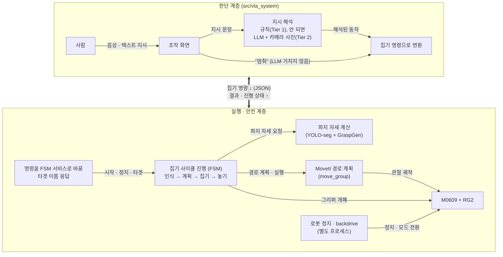
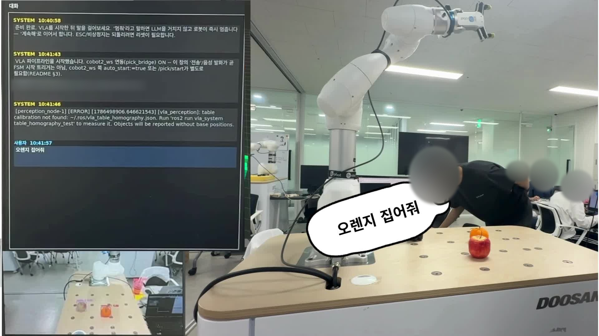
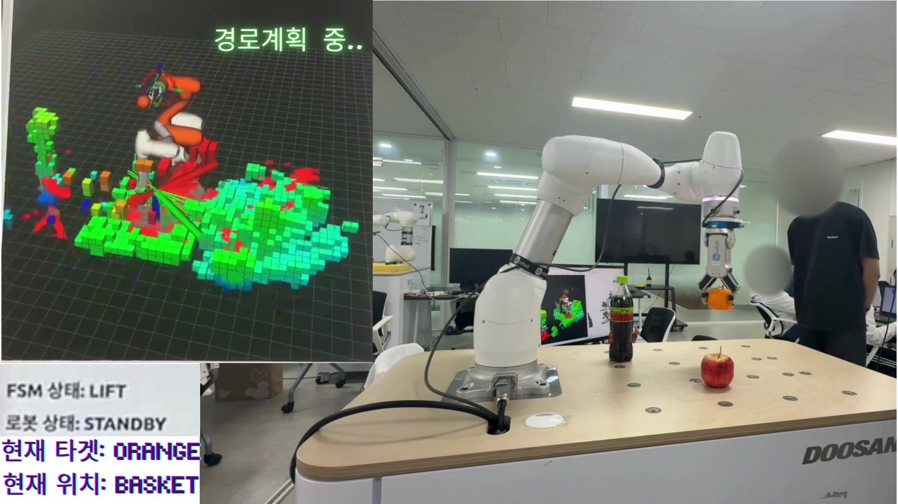
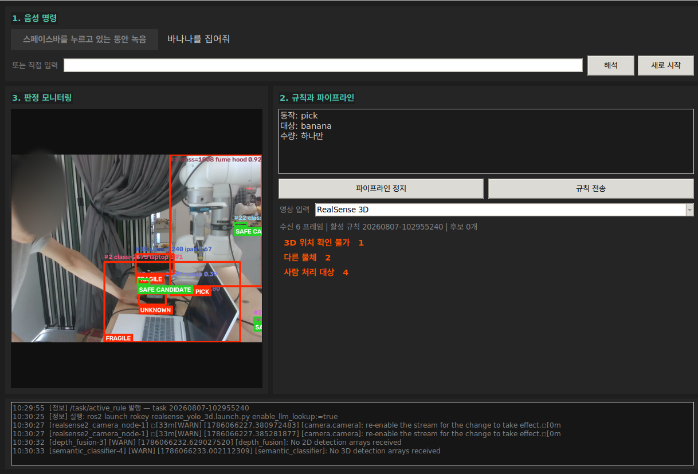
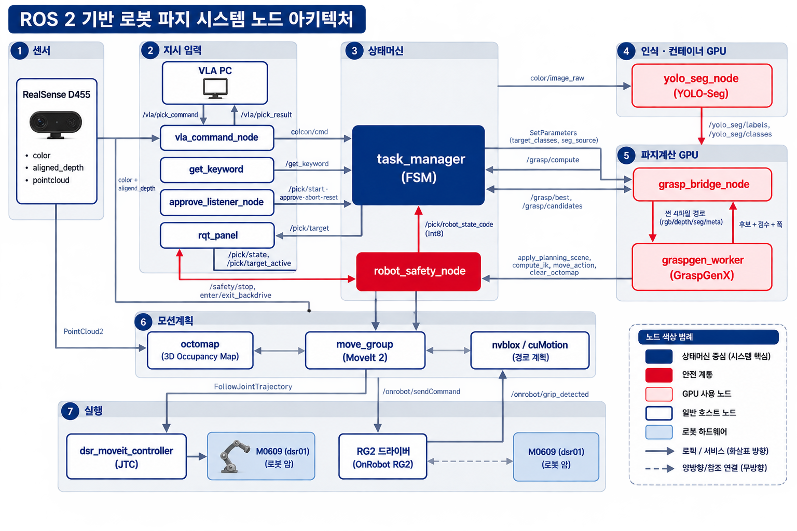
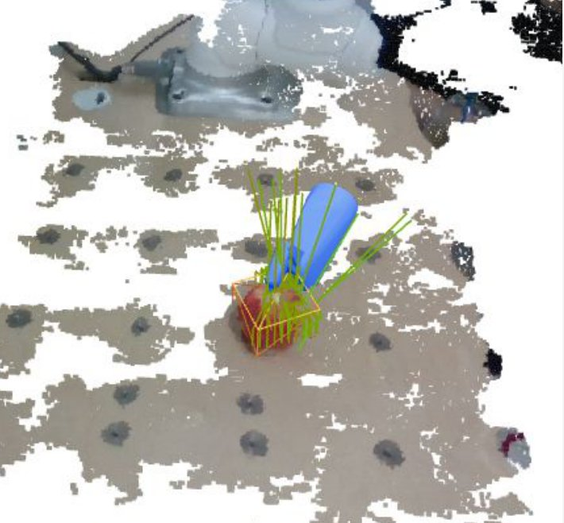
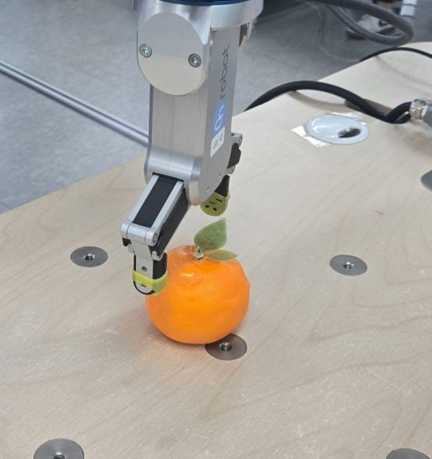
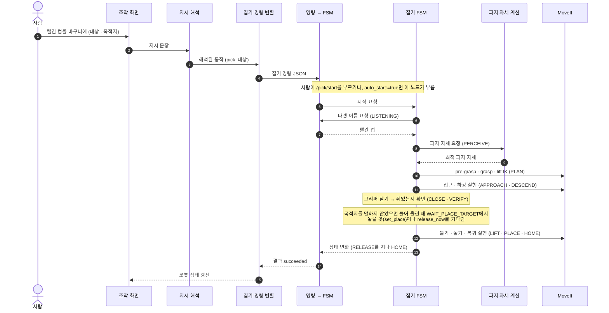
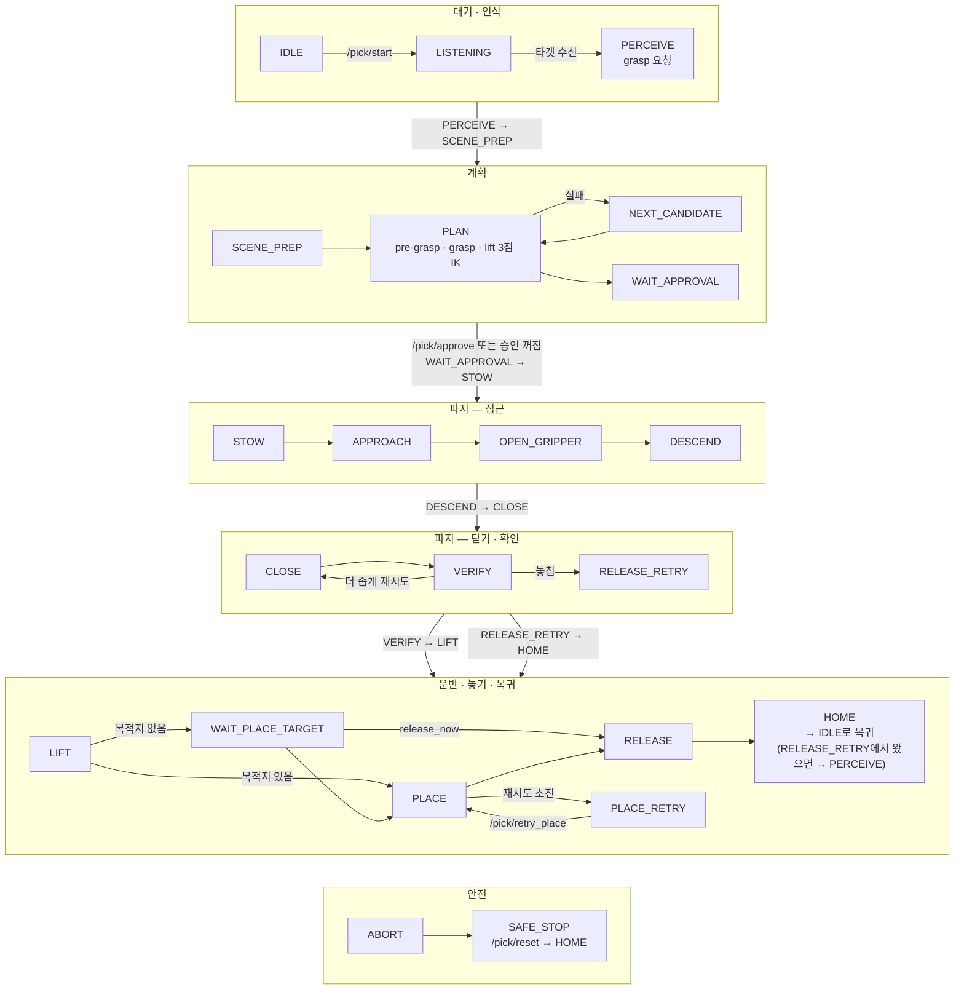
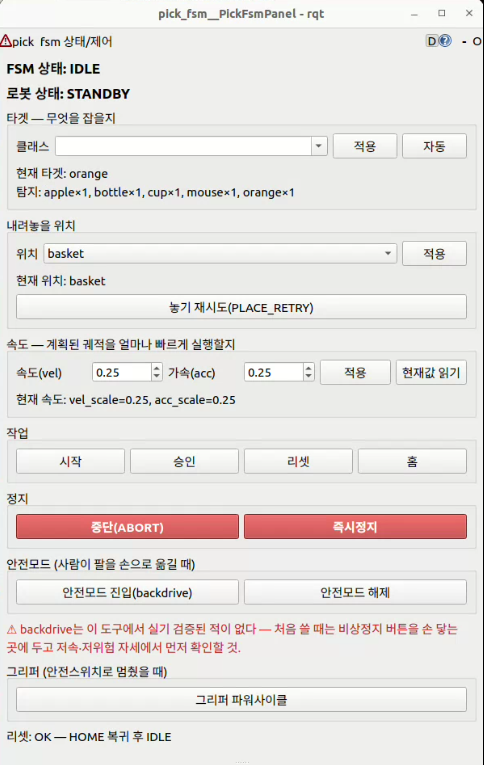

# M0609 VLA Picking System

> 두산로보틱스 ROKEY 부트캠프 협동-2 프로젝트(5인 팀) 제출 스냅샷입니다. 코드는 제출본 그대로이고, 공개용으로 README만 다시 정리했습니다.

> ▶️ **[1분 시연 영상](https://youtu.be/bOec0yE8m94)** — 이 프로젝트를 가장 빨리 파악할 수 있는 자료입니다. 사진과 함께 만든 과정·팀에서 일한 방식은 🖼️ [프로젝트 소개 페이지](https://gwanhuigim.github.io/vla.html)에 있습니다.

자연어로 지시하면 Doosan M0609 + OnRobot RG2가 고정 카메라로 물체를 인식하고, 집어서 지정한 곳에 놓습니다.
사람은 "무엇을 · 몇 개를 · 어디로"만 말하고, 로봇이 어떻게 움직이고 언제 멈출지는 LLM이 아니라 FSM이 정하도록 나눴습니다.

> **핵심 설계**: 판단(LLM)과 실행·안전(FSM)을 서로 다른 노드·패키지로 나누고, 둘 사이는 JSON 채널로만 주고받습니다(명령 `/vla/pick_command`, 결과 `/vla/pick_result`, 상태 `/vla/pick_status`). 모션 취소, 그리퍼 개폐, 물체 보유 상태, 충돌 씬 관리는 코드상 FSM(`task_manager`) 쪽에만 있습니다. 그래서 LLM 응답이 늦거나 틀려도 정지·그리퍼 판단은 FSM 규칙을 따르도록 분리했습니다.

## 본인 담당

5인 팀을 판단·인식을 맡는 VLM 파트 3명과 로봇 구동을 맡는 M0609 파트 2명으로 나눴고, 저는 M0609 파트였습니다. 판단 계층(GUI·지시 해석·미션)과 cuMotion 재계획 코드 본체는 팀 작업이고, 아래는 그중 제가 맡은 몫입니다.

- **VLA 작업 지시 전달 및 디버깅·모니터링을 위한 FSM 상태 구분과 감지 실패 예외 처리 연동(공동작업)** — FSM은 집기 작업을 단계별 상태로 나눠 순서를 제어하는 구조입니다. 판단 계층의 집기 명령이 FSM 서비스 호출로 바뀌어 들어오고, FSM의 진행 상태와 결과가 다시 판단 계층으로 올라가는 경로입니다.
  코드: [`states.py`](src/pick_fsm/pick_fsm/states.py) · [`task_manager.py`](src/pick_fsm/pick_fsm/task_manager.py) · [`vla_command_node.py`](src/voice_processing/voice_processing/vla_command_node.py)
- **파지 모델(GraspGenX)과 실물 그리퍼(RG2) 차이 실측·보정** — 현장 RG2는 로봇 팔과의 사이에 브라켓(22mm)이 끼어 있고, 다물었을 때 손끝이 모델보다 38mm 길며, 벌릴수록 손끝까지 길이가 짧아집니다. GraspGenX 모델은 고치지 않고 실측값과 벌림 폭별 손끝 길이 보정표를 그리퍼 코드에 넣었습니다. 손끝 위치를 추정하는 값이고 로봇 목표 자세를 고치는 보정은 아니며, 파지 성공률에 준 효과는 확인하지 않았습니다.
  코드: [`rg2.py`](src/pick_fsm/pick_fsm/rg2.py)
- **GPU 메모리 대응** — 노트북 GPU(8GB)에서 메모리가 모자라지 않도록 GraspGenX 파지 후보 수(`num_grasps`)를 기본 200개에서 64개로 줄였습니다. 물체 인식(YOLO) 노드가 중복 실행되던 문제는 단일 실행 잠금과 실행 스크립트로 막았습니다(당시 기록: 같은 토픽을 내보내는 노드 10개→1개).
  코드: [`grasp_bridge_node.py`](src/graspgenx_perception/graspgenx_perception/grasp_bridge_node.py) · [`yolo_seg_node.py`](src/graspgenx_perception/graspgenx_perception/yolo_seg_node.py) · [`graspx_container.sh`](scripts/fsm/graspx_container.sh)
- **구동 중 정지 후 재계획 연결** — FSM이 move_group에 이동을 맡길 때 `replan` 옵션(`replan_attempts` 3회)을 켜, 이동 중 사람이 작업영역에 손을 넣어 장면이 바뀌면 멈추고 새 경로로 다시 계획하게 했습니다. 그래도 실패하면 FSM이 바깥에서 재시도하거나 다음 파지 후보로 넘어갑니다. OMPL 경로에서 이 동작을 실기로 확인했습니다(cuMotion 동적 회피와는 별개입니다).
  코드: [`pick_fsm.yaml`](src/pick_fsm/config/pick_fsm.yaml) · [`task_manager.py`](src/pick_fsm/pick_fsm/task_manager.py) · [`moveit_bridge.py`](src/pick_fsm/pick_fsm/moveit_bridge.py)
- **장애물 지도 서비스 점검 게이트(공동작업, 실험 코드)** — cuMotion은 장애물 지도(nvblox) 서비스가 죽어 있어도 장애물이 없는 것으로 보고 계획에 성공할 수 있습니다. 그래서 팀의 cuMotion 모션 코드 위에, 이 서비스가 없으면 이동을 막는 게이트를 제안·구현했습니다. 궤적 실행 쪽 안전 계층은 팀 코드가, 충돌 회피 계산은 NVIDIA 스택이 맡습니다. 최종 작업 흐름(pick FSM)에는 연결하지 않은 실험 코드이고, 실제 장애물을 넣은 회피 실기는 하지 않았습니다.
  코드: [`arm.py`](src/cumotion/cumotion/arm.py)
- **설정값 정본은 yaml, 실행 선택은 launch 인자로 분리** — 실기에서 바꾸는 FSM 값은 `pick_fsm.yaml`에, 탐지 대상·기본 타겟·물체 치수는 ws 루트 `objects.yaml` 한 곳에 두고, 실행마다 고르는 값은 launch 인자로 나눴습니다. 자세한 구조는 [launch · 파라미터 분리](#launch--파라미터-분리)에 있습니다.
  코드: [`pick_fsm.yaml`](src/pick_fsm/config/pick_fsm.yaml) · [`objects.yaml`](config/objects.yaml) · [`pick_fsm.launch.py`](src/pick_fsm/launch/pick_fsm.launch.py)

<details>
<summary>시스템 구성도</summary>

칸은 하는 일, 화살표는 주고받는 내용입니다. 노드·토픽 이름과 코드 위치는 그림 아래 표에 있습니다. 굵은 화살표는 판단 계층과 실행 계층의 경계입니다.



| 칸 | 코드 | 주고받는 토픽·서비스 |
|---|---|---|
| 조작 화면 | [`vla_gui.py`](src/vla_system/vla_system/vla_gui.py) | 발행 `/vla/user_utterance`(지시 문장) `/vla/robot/pause`(멈춤 버튼 · 음성 "멈춰") `/vla/estop`(비상정지 버튼 · ESC) · 구독 `/vla/agent/reply` `/vla/robot/state` `/vla/pick_status` |
| 지시 해석 | [`nodes/agent_node.py`](src/vla_system/vla_system/nodes/agent_node.py), Tier 분기 [`agent/skill_tier.py`](src/vla_system/vla_system/agent/skill_tier.py) | 구독 `/vla/user_utterance` · 발행 `/vla/robot/action`(`RobotAction`) |
| 집기 명령으로 변환 | [`nodes/vla_pick_bridge_node.py`](src/vla_system/vla_system/nodes/vla_pick_bridge_node.py) | 구독 `/vla/robot/action` `/vla/robot/pause` `/vla/estop` `/vla/pick_result` · 발행 `/vla/pick_command` `/vla/robot/state` |
| 명령을 FSM 서비스로 바꿈 | [`vla_command_node.py`](src/voice_processing/voice_processing/vla_command_node.py) | 구독 `/vla/pick_command` · 호출 `/pick/*`(멈춤 → `/pick/pause`, 비상정지 → `/pick/abort` 등) · 응답 `/get_keyword` · 발행 `/vla/pick_result` `/vla/pick_status` |
| 집기 사이클 진행 | [`task_manager.py`](src/pick_fsm/pick_fsm/task_manager.py), 상태·전이표 [`states.py`](src/pick_fsm/pick_fsm/states.py), MoveIt 호출 [`moveit_bridge.py`](src/pick_fsm/pick_fsm/moveit_bridge.py), 그리퍼 [`rg2.py`](src/pick_fsm/pick_fsm/rg2.py) | 제공 `/pick/*` · 호출 `/get_keyword` `/grasp/compute` `/compute_ik` `/move_action` `/onrobot/sendCommand` · 발행 `/pick/state` |
| 파지 자세 계산 | [`grasp_bridge_node.py`](src/graspgenx_perception/graspgenx_perception/grasp_bridge_node.py), [`yolo_seg_node.py`](src/graspgenx_perception/graspgenx_perception/yolo_seg_node.py) | 제공 `/grasp/compute` · 발행 `/grasp/best` `/grasp/candidates` |
| MoveIt 경로 계획 | `move_group` (MoveIt) | `/compute_ik` · `/move_action` |
| 로봇 정지 · backdrive | [`robot_safety_node.py`](src/pick_fsm/pick_fsm/robot_safety_node.py) | 제공 `/safety/stop` `/safety/enter_backdrive` `/safety/exit_backdrive` · 발행 `/pick/robot_state_code` `/pick/robot_state_text` |

</details>

## 목차

_주제별 바로가기입니다. 본문 배치 순서와 다를 수 있습니다._

- **개요·구조**: [본인 담당](#본인-담당) · [환경 · 장비](#환경--장비) · [저장소 구성](#저장소-구성) · [무엇을 할 수 있나](#무엇을-할-수-있나) · [시스템 구조](#시스템-구조)
- **돌려 보기**: [설치](#설치) · [실행](#실행)
- **검증·한계·참고**: [한계 · 미완성](#한계--미완성) · [더 읽을 문서](#더-읽을-문서) · [검증](#검증) · [License](#license)

## 환경 · 장비

<details>
<summary>요구 환경 · 장비 구성</summary>

- Ubuntu 22.04, ROS 2 Humble, Python 3.10
- NVIDIA GPU + CUDA 필수 — GraspGenX와 cuMotion은 CPU로 돌지 않습니다(개발 PC: RTX 4060 Laptop)
- Docker + `nvidia-container-toolkit`(`--gpus all` 지원)

| 구성 요소 | 종류 | 설정 |
| --- | --- | --- |
| Robot | Doosan **M0609** | namespace `dsr01`, IP `192.168.1.100`(`m0609_rg2_bringup` launch) |
| Gripper | OnRobot **RG2** | `src/cobot_rg2`의 xacro·bringup·MoveIt 설정 |
| Vision | Intel RealSense **D435i** × 1 | 🔴 **고정형(eye-to-hand)** — 작업대 옆에 세워 둡니다. 로봇 팔에 달지 않습니다 |
| PC | RTX 4060 Laptop | GraspGenX · cuMotion GPU 연산 |

카메라 위치나 마운트를 바꾸면 eye-to-hand 캘리브레이션을 다시 해야 합니다.

</details>

## 저장소 구성

```
.
├── src/
│   ├── pick_fsm/              ★ 실행·안전 계층 — task_manager(FSM) · moveit_bridge · robot_safety_node · rqt 패널
│   ├── pick_fsm_msgs/         ComputeGrasp / AcquireTarget 인터페이스
│   ├── voice_processing/      ★ 경계 수신부 vla_command_node (+ 구버전 마이크 노드)
│   ├── graspgenx_perception/  ★ YOLO-seg + GraspGen 파지 자세 계산
│   ├── cobot_rg2/             M0609 + RG2 bringup · MoveIt 설정
│   ├── cumotion/              동적 회피 실험 (pick_fsm 미연결)
│   ├── object_detection/      YOLO 가중치 share 경로
│   ├── vla_system/            ★ 판단 계층 — GUI · 에이전트 · 규칙 · bridge
│   ├── vla_interfaces/        판단 계층 내부 메시지 (경계를 넘지 않음)
│   └── PACKAGES.md            패키지별 상세 · FSM 상태도
├── config/                    objects.yaml · cumotion · nvblox 설정
├── docker/                    GraspGenX 컨테이너 (Dockerfile.graspx)
├── docs/                      RUNBOOK · 경계 계약 · 실기 제약 · 이미지
├── scripts/
│   ├── build.sh               빌드 (fsm / vla 분리)
│   ├── fetch_externals.sh     외부 저장소 받기
│   ├── fsm/                   로봇 쪽 보조 스크립트
│   └── vla/                   판단 쪽 보조 스크립트 (env.sh 등)
├── requirements-vla.txt       판단 계층 파이썬 의존성 (393줄)
└── .env.example               API 키 입력 양식
★ = 아래 "핵심 코드 바로가기" 파일이 있는 곳
```

<details>
<summary>핵심 코드 바로가기</summary>

| 파일 | 하는 일 | 설명 위치 |
| --- | --- | --- |
| ⭐ **[`pick_fsm/task_manager.py`](src/pick_fsm/pick_fsm/task_manager.py)** | 인식 → 계획 → 집기 → 놓기 사이클을 조율하는 FSM 노드 | [시스템 구조](#시스템-구조) |
| **[`pick_fsm/states.py`](src/pick_fsm/pick_fsm/states.py)** | FSM 상태(`State`)와 허용 전이(`TRANSITIONS`) 정의 | [FSM 상태 흐름](#fsm-상태-흐름) |
| **[`voice_processing/vla_command_node.py`](src/voice_processing/voice_processing/vla_command_node.py)** | 계층 경계: `/vla/pick_command` JSON을 `/pick/*` 서비스 호출로 변환 | [시스템 구조](#시스템-구조) |
| **[`graspgenx_perception/grasp_bridge_node.py`](src/graspgenx_perception/graspgenx_perception/grasp_bridge_node.py)** | GraspGen 파지 후보를 받아 점수·도달 반경·접근축으로 걸러 선택 | [시스템 구조](#시스템-구조) |
| **[`vla_system/agent/skill_tier.py`](src/vla_system/vla_system/agent/skill_tier.py)** | 자연어 지시를 규칙(Tier 1)과 LLM(Tier 2)으로 나눠 해석 | [무엇을 할 수 있나](#무엇을-할-수-있나) |

</details>

<details>
<summary>저장소에 없는 것</summary>

### 저장소에 없는 것

| 항목 | 용량 | 받는 법 |
| --- | --- | --- |
| GraspGenX · isaac_ros(cuMotion · nvblox) · Doosan 드라이버 | 20GB+ (제출 당시 참고값) | `./scripts/fetch_externals.sh` |
| `.venv/` | 6.6G (제출 당시 참고값) | `requirements-vla.txt`로 새로 만듭니다 |
| 도커 이미지 | 7G (제출 당시 참고값) | `docker/Dockerfile.graspx`로 빌드합니다 |
| `build/ install/ log/` | 1.7G (제출 당시 참고값) | 절대경로가 박혀 있어 옮겨 쓸 수 없습니다. 새로 빌드합니다 |
| `data/graspgenx_scene/` | 2.3G (제출 당시 참고값) | 실행 중 생기는 출력물이며 입력 데이터가 아닙니다 |
| `.env` | — | 🔴 API 키 파일. `.env.example`을 보고 직접 만듭니다 |

</details>

## 무엇을 할 수 있나

**핵심 기능**

| 기능 | 어디서 | 어떻게 |
| --- | --- | --- |
| 자연어 지시 해석 | `vla_system/agent_node` · [`agent/skill_tier.py`](src/vla_system/vla_system/agent/skill_tier.py) | 단순 명령은 규칙(Tier 1)으로 바로, 맥락이 필요한 명령은 `gpt-5-mini` + 카메라 사진(Tier 2)으로 해석 |
| 다중 물체 미션 | [`vla_system/agent/mission.py`](src/vla_system/vla_system/agent/mission.py) | "다 담아줘"를 하나씩 순차 처리하고, 중간에 지시를 바꿀 수 있음 |
| 파지 자세 계산 | `graspgenx_perception/grasp_bridge_node` | YOLO-seg로 대상을 찾고, GraspGen 후보를 점수·도달 반경·접근축으로 걸러 선택 |
| pick 사이클 실행 | `pick_fsm/task_manager` · [`states.py`](src/pick_fsm/pick_fsm/states.py) | 25개 상태로 인식 → 계획 → 집기 → 놓기를 조율, move_group(OMPL)으로 계획·실행 |
| LLM 없는 정지 경로 | `vla_gui` → `vla_pick_bridge_node`, `robot_safety_node` | 정지 버튼은 STT·LLM 대기 없이, 음성 "멈춰"는 STT 뒤 LLM을 건너뛰어 FSM을 `PAUSED`로, Doosan 안전 서비스는 별도 프로세스에서 제공 |

| 지시 | 시스템이 하는 일 |
| --- | --- |
| "사과 바구니에 담아줘" | 인식 → 파지 계획 → (승인 게이트, 기본 꺼짐) → 집기 → 바구니에 놓기 |
| "이거 집어줘" (손가락으로 가리키며) | 카메라 사진에서 가리킨 물체를 골라 픽셀 좌표로 넘깁니다¹ |
| "사과 집어줘" (목적지 없이) | 들어 올린 뒤 `WAIT_PLACE_TARGET`에서 물체를 든 채 기다립니다. "테이블에 놔"(set_place) 또는 "그냥 거기 놔"(release_now)로 끝납니다 |
| "보이는 과일 다 담아줘" | 미션 supervisor가 하나씩 순차로 처리합니다. 중간에 지시를 바꿀 수 있습니다 |
| "멈춰" | GUI가 LLM을 거치지 않고 pause 명령을 bridge로 보내고(정지 버튼은 STT 대기도 없음, 음성은 STT로 글자가 된 뒤 정지 패턴으로 판별), FSM이 `PAUSED`로 갑니다. "계속해"로 이어 갑니다 |
| "컵은 앞으로 담지 마" | 규칙으로 기억해 이후 "다 담아줘"에서 컵을 뺍니다 |

¹ [`vla_command.launch.py`](src/voice_processing/launch/vla_command.launch.py)로 띄울 때(`pixel_policy` 기본값 `select`) 동작입니다. 노드를 단독 실행하면 기본값이 `warn`이라 픽셀을 무시합니다.

| 음성 명령 처리 | 경로 계획 화면 |
| --- | --- |
|  |  |
| "오렌지 집어줘" 음성 명령이 실제 pick으로 이어지는 장면 | FSM 상태·타겟·목적지 표시와 RViz의 octomap 기반 경로 계획 화면 |

**VLA GUI** — 음성 입력, 해석된 규칙·파이프라인 상태, 인식·안전 분류·파지 후보를 한 화면에서 봅니다.



## 시스템 구조



> 그림의 "RealSense D455"는 실제 사용 카메라 **D435i**(eye-to-hand 1대)와 다릅니다. 그림의 `get_keyword`·`approve_listener_node` 노드도 현재 지시 경로(`vla_gui` → `agent_node` → `vla_pick_bridge_node` → `vla_command_node`)가 아닙니다 — 현재는 `vla_command_node`가 `/get_keyword` 서비스에 응답합니다([현재 경로 / 실험·구버전](#현재-경로--실험구버전)).

| 파지 후보 선택 | 실물 RG2 파지 |
| --- | --- |
|  |  |
| GraspGen 후보를 점수·도달 반경·접근축 조건으로 거른 결과 | M0609 + OnRobot RG2가 작업대 위 물체를 집는 장면 |

<details>
<summary>계층별 설명 (인식 · 판단 · 경계 · 실행·안전)</summary>

**인식** — 고정형(eye-to-hand) RealSense D435i 1대와 YOLO-seg로 대상을 찾고, eye-to-hand 캘리브레이션(AX = XB) 결과로 카메라 좌표를 로봇 base 좌표로 바꿉니다. `graspgenx_perception`의 `grasp_bridge_node`가 컨테이너 안의 GraspGen에서 파지 후보 64개(`num_grasps`, 8GB VRAM 기준)를 받아 점수·도달 반경·접근축 조건으로 거르고 고릅니다. FSM의 기본 호출은 `grasp_source:=legacy_trigger`(`std_srvs/Trigger`)라 그리퍼 폭은 상수(`default_width_m`)로 채웁니다. 물체별 폭까지 받으려면 `ComputeGrasp` 경로(`grasp_source:=compute_grasp`)를 씁니다.

**판단** — `src/vla_system`. `agent_node`는 단순 명령을 규칙(Tier 1)으로, 맥락이 필요한 명령을 `gpt-5-mini` + 카메라 사진(Tier 2, `config/system.yaml`)으로 처리합니다. `vla_pick_bridge_node`만 결정을 `/vla/pick_command` JSON으로 바꿔 내보내고, 팔을 직접 움직이지 않습니다. 이 bridge는 launch 기본값이 꺼짐(`enable_pick_bridge:=false`)이라 GUI에서 켜야 FSM 쪽으로 명령이 갑니다.

**경계** — `voice_processing/vla_command_node`가 JSON을 `/pick/*` 서비스 호출로 바꿉니다. 타겟 지시는 FSM이 `LISTENING` 상태에서 `/get_keyword`를 부를 때 이 노드가 응답하는 방식(pull)으로 전달됩니다.

**실행·안전** — `pick_fsm/task_manager`가 25개 상태로 인식 → 계획 → 실행 사이클을 조율하고, `moveit_bridge`가 move_group에 계획·실행을 맡깁니다. `robot_safety_node`는 `task_manager`와 별도 프로세스로 Doosan 안전 서비스(`/safety/stop` = MoveStop, backdrive 진입/해제)를 감쌉니다. FSM이 멈춰도 이 노드의 서비스는 따로 호출할 수 있게 나눴지만, 서비스는 결과를 기다리지 않고 바로 응답(fire-and-forget)하므로 실제 결과는 `/pick/robot_state_text`로 확인합니다.

</details>

<details>
<summary>집기 명령 한 번의 흐름 (sequence)</summary>

승인 단계가 꺼진 기본 설정에서 정상적으로 끝나는 경우만 그렸습니다. 괄호 안은 FSM 상태입니다.



</details>

### FSM 상태 흐름

상태와 허용 전이는 `src/pick_fsm/pick_fsm/states.py`의 `State`와 `TRANSITIONS` 한 곳에만 있습니다. 상태는 기능별로 다섯 묶음입니다.

| 묶음 | 하는 일 | 상태 |
|---|---|---|
| 인식 | 음성으로 타겟을 받고 파지 후보를 요청 | `LISTENING` → `PERCEIVE` |
| 계획 | 대상을 충돌 씬에 등록하고 접근·파지·들기 3점 IK를 풂, 실패하면 다음 후보 | `SCENE_PREP` → `PLAN` ↔ `NEXT_CANDIDATE`, `WAIT_APPROVAL`(사람 승인, 기본 꺼짐) |
| 파지 | 그리퍼를 닫은 채 접근 → 열고 하강 → 닫고 파지 확인, 놓치면 다시 | `STOW` → `APPROACH` → `OPEN_GRIPPER` → `DESCEND` → `CLOSE` → `VERIFY`, `RELEASE_RETRY` (`REGRASP`는 스캐폴드) |
| 운반·놓기 | 들어 올려 목적지로 옮기고 놓은 뒤 홈 복귀 | `LIFT` → (`WAIT_PLACE_TARGET`) → `PLACE` ↔ `PLACE_RETRY` → `RELEASE` → `HOME` |
| 사람 개입·안전 | 일시정지·중단·정지 유지·실패 통보 | `PAUSED`, `ABORT` → `SAFE_STOP`, `SPEAK_FAIL` (대기: `IDLE`) |

<details>
<summary>상태 흐름도 · 전이 규칙</summary>

아래는 정상 경로와 주요 분기만 그린 것입니다.



- [`pick_fsm.launch.py`](src/pick_fsm/launch/pick_fsm.launch.py)의 `require_approval` 기본값은 `false`라 `WAIT_APPROVAL`은 곧바로 통과합니다. 켜려면 `require_approval:=true`.
- 진행 중인 상태 대부분(IDLE·SPEAK_FAIL·ABORT·SAFE_STOP 제외)에서 `PAUSED`로 갈 수 있고, `PAUSED`는 사람 명령(resume·release_now·home·stow·abort)으로만 빠져나옵니다. 거의 모든 상태에서 `ABORT`로 갈 수 있습니다.
- `SAFE_STOP`과 `RELEASE_RETRY`는 곧장 재인식하지 않고 `HOME`을 거칩니다. 팔이 작업 공간에 남은 채 다시 촬영하면 그리퍼가 물체로 잡히기 때문입니다.
- 물체를 들고 있을 수 있는 상태(`HOLDING_STATES`)에서는 ABORT가 나도 그리퍼를 열지 않습니다.
- 실행 중 씬이 바뀌었을 때의 대응은 별도 상태가 아니라 move_group의 `replan` 파라미터(`replan_attempts` 3회)이고, 그래도 실패하면 FSM이 바깥에서 재시도하거나 다음 후보로 넘어갑니다.

</details>

운용 중에는 rqt FSM 패널로 상태 확인, 타겟 지정, 속도 조절, 비상정지, 안전 모드 진입을 합니다.



### launch · 파라미터 분리

실기에서 바꾸는 값은 yaml에, 실행할 때마다 고르는 값은 launch 인자에 두었습니다. 코드를 고치지 않고 값을 바꾸고, 같은 값이 여러 곳에 흩어지지 않게 하려는 구조입니다.

| 파일 | 맡는 값 | 읽는 쪽 |
| --- | --- | --- |
| [`config/objects.yaml`](config/objects.yaml) (ws 루트) | 탐지 대상(`detect`), 기본 타겟(`pick_default`), 물체별 반경·높이(`dimensions`) | `yolo_seg_node`(컨테이너), `pick_fsm.launch.py`, `graspx.launch.py`, `vla_command.launch.py` |
| [`src/pick_fsm/config/pick_fsm.yaml`](src/pick_fsm/config/pick_fsm.yaml) | `task_manager`의 승인 게이트, 대기 시간, MoveIt 그룹·frame, 파지·배치 관련 값 | `pick_fsm.launch.py`(`params_file:=`) |
| [`src/vla_system/config/system.yaml`](src/vla_system/config/system.yaml) | 인식·판단·bridge 노드의 토픽, 카메라 주기, 모델·임계값 | `vla_system.launch.py`(`params_file:=`) |
| [`src/cumotion/config/dynamic_avoid.yaml`](src/cumotion/config/dynamic_avoid.yaml) | 재계획 주기, lookahead, 목표 자세 | `dynamic_avoid.launch.py`(`params_file:=`) |
| `.env.example` 3개 | API 키(OpenAI) | `agent_node`, `get_keyword` 등. 실제 `.env`는 저장소에 없습니다 |

- **`objects.yaml` 한 곳에서 무엇을 보고 무엇을 집을지 정합니다.** 탐지 노드, 파지 bridge, 음성 명령 검사가 같은 목록을 읽습니다. 컨테이너가 ws를 호스트와 같은 절대경로로 마운트하므로, 호스트 노드와 컨테이너 노드가 같은 파일을 봅니다.
- **launch 인자는 yaml 위에 얹힙니다.** `parameters=[params_file, {launch 인자}]` 순서라, `require_approval:=true`·`target:=apple`·`mode:=check`처럼 실행 때 고른 값이 yaml 기본값을 이깁니다. 두 곳에 같은 값이 있는 항목(예: `require_approval`)은 yaml 주석에 그 사실을 적었습니다.
- **실측으로 확정하지 않은 값에는 `UNVERIFIED`를 붙였습니다**(`pick_fsm.yaml` 첫머리 규칙).
- **`pick_fsm.launch.py`는 bringup·카메라·MoveIt을 일부러 include하지 않습니다.** 이미 띄운 노드가 두 번 뜨면 `robot_description`이 충돌하기 때문입니다. 기동 순서는 [실행](#실행)과 `docs/RUNBOOK.md`를 따릅니다.
- **`vla_system.launch.py`는 `enable_*` 인자로 노드를 켜고 끕니다.** `enable_pick_bridge`는 기본 꺼짐이라, 판단 계층만 단독으로 띄워도 FSM 쪽에 명령이 가지 않습니다.

### 현재 경로 / 실험·구버전

| 구분 | 무엇 | 지위 |
| --- | --- | --- |
| 지시 입력 | `vla_gui` → `agent_node` → `vla_pick_bridge_node` → `vla_command_node` | **현재 경로** |
| 지시 입력 | `voice_processing`의 `get_keyword`·`wakeup_word`·`stt`(마이크 노드가 직접 `/get_keyword` 제공) | 구버전. `LISTENING` 상태 자체는 현재 경로도 씁니다 |
| 모션 계획 | move_group + OMPL(`planning_pipeline` 기본값) + `replan` | **현재 경로** |
| 모션 계획 | `planning_pipeline:=isaac_ros_cumotion` | 선택 사항. 외부 isaac_ros 컨테이너 필요, 소스는 저장소에 없음 |
| 동적 회피 | `src/cumotion`의 `dynamic_avoid`·`reactive_replan` | 실험·미연결. pick_fsm 연결은 보류 상태(`src/cumotion/README.md`) |
| 재파지 | `REGRASP` 상태 | 스캐폴드(`regrasp_enabled`) |

### 깨면 안 되는 규칙 (불변식)

번호는 코드 주석·테스트에서 쓰는 팀 내부 번호입니다(예: [`vla_gui.py`](src/vla_system/vla_system/vla_gui.py)의 I4, `mission.py`의 I6, [`test_pick_fsm.py`](src/pick_fsm/test/test_pick_fsm.py)의 I12). 빠진 번호는 이 저장소에 정의가 남아 있지 않습니다.

<details>
<summary>불변식 I1–I13 표</summary>

| 번호 | 규칙 |
| --- | --- |
| I1 | 계층 경계는 JSON 채널만 씁니다. `vla_interfaces` 메시지는 FSM 쪽으로 넘어가지 않습니다. |
| I2 | VLM은 `/pick/approve`를 부르지 않습니다. 판단 계층에 그 코드 경로를 두지 않았습니다. |
| I4 | 정지 경로에 LLM이 끼지 않습니다. GUI 정지 버튼은 STT·LLM 대기 없이, 음성 "멈춰"는 STT 뒤 LLM 없이 bridge로 바로 나갑니다(`vla_gui.py` `handle_user_text`·`pause_robot`). |
| I5 | 물체를 든 채 중단·일시정지하면 그리퍼를 자동으로 열지 않습니다(정상 배치 단계의 `RELEASE`는 예외). 떨어뜨리는 쪽이 멈추는 쪽보다 위험하기 때문입니다. |
| I6 | 동시에 진행하는 action은 1개로 제한합니다. 팔이 하나입니다. |
| I7 | 상태 전이는 `states.py` 한 곳에서만 관리합니다. |
| I11 | `PAUSED`에서는 자율 동작이 없습니다. 시간이 지나도 스스로 재개·배치하지 않습니다. |
| I12 | 기본 설정(`wait_place_timeout_sec=0.0`)에서는 놓을 위치를 기다리는 동안 시간 경과만으로 자동 배치하지 않습니다. |
| I13 | 그리퍼는 팔이 멈춘 상태에서만 엽니다. |

</details>

## 한계 · 미완성

- **실기 안전**: `pick_fsm.launch.py`는 항상 실기를 움직이고 승인 게이트도 기본 꺼짐입니다. 끌 때는 `/pick/stow` 후 `IDLE`을 확인합니다([종료 절차](#종료-절차)).
- **연결되지 않은 기능**: 동적 장애물 회피(`src/cumotion`의 `dynamic_avoid`·`reactive_replan`)는 pick_fsm에 연결하지 않았고, 현재 대응은 move_group `replan`뿐입니다. `REGRASP`(eye-in-hand 재파지)는 스캐폴드이고, 기본 `grasp_source:=legacy_trigger`는 그리퍼 폭을 상수로 씁니다.
- **저장소에 없는 자산**: `isaac_ros_cumotion`·GraspGenX·드라이버 소스와 `.venv`는 저장소에 없습니다. [`fetch_externals.sh`](scripts/fetch_externals.sh)가 받는 공개 upstream은 개발 당시 쓴 사본과 다를 수 있습니다.
- **그대로 안 도는 문서**: `docs/RUNBOOK.md`는 개발 PC의 경로·개인 alias를 담고 있습니다.

<details>
<summary>세부 사항</summary>

- `src/cumotion/README.md` 기준 미해결: 그리퍼 SRDF 자기충돌 쌍 누락으로 계획이 조용히 버려질 수 있음, 컨테이너 컨트롤러 스포너의 호스트 서비스 호출 문제.
- 링크 문서끼리 기본값 서술이 어긋난 곳이 있습니다(`require_approval`, `pixel_policy`, `table`/`discard` 관절값). 어긋나면 코드(launch 파일)가 기준입니다.

</details>

## 더 읽을 문서

| 문서 | 내용 | 지위 |
| --- | --- | --- |
| [발표 자료(PDF, 72쪽)](https://github.com/gwanhuiGIM/Rokey_cobot2/releases/download/presentation/cobot2_presentation.pdf) | 세부 기술 발표 자료 | 참고 |
| [docs/RUNBOOK.md](docs/RUNBOOK.md) | 터미널 배치와 실행 순서 | 정본(개발 PC 경로 기준) |
| [docs/fsm/vla-bridge-contract.md](docs/fsm/vla-bridge-contract.md) | 두 계층을 잇는 JSON 스키마 | 정본 |
| [docs/fsm/context/constraints.md](docs/fsm/context/constraints.md) | 실기 운용 중 알아낸 사실(설계 문서와 다른 점) | 정본 |
| [src/PACKAGES.md](src/PACKAGES.md) | 패키지별 상세 · FSM 상태도 | 정본 |
| [docs/fsm/README.md](docs/fsm/README.md) | 로봇 쪽 문서 지도 | 참고 |
| `src/<pkg>/README.md` | pick_fsm · voice_processing · graspgenx_perception · cobot_rg2 · cumotion 패키지 문서 | 패키지 정본 |

## 설치

<details>
<summary>설치 절차 (외부 저장소 · API 키 · 컨테이너 · 빌드)</summary>

```bash
git clone <이 저장소> ~/m0609_vla_ws && cd ~/m0609_vla_ws

# ① 외부 저장소 (GraspGenX · Isaac ROS · Doosan 드라이버)
./scripts/fetch_externals.sh

# ② API 키
cp .env.example .env && chmod 600 .env && $EDITOR .env

# ③ 판단 계층 파이썬 환경
#    --system-site-packages 가 없으면 venv 안에서 rclpy를 못 찾습니다
python3 -m venv --system-site-packages .venv
source .venv/bin/activate && pip install -r requirements-vla.txt && deactivate

# ④ GraspGenX 컨테이너 (YOLO-seg + GraspGen)
#    마운트 경로를 호스트와 같게 둡니다 — 스크립트가 호스트 경로를 컨테이너 안에서 그대로 source합니다
docker build -f docker/Dockerfile.graspx -t od_kimkh:rebuilt docker
docker run -d --name od_kimkh \
  --gpus all --network host --ipc host \
  -e DISPLAY=$DISPLAY -e ROS_DOMAIN_ID=93 -e RMW_IMPLEMENTATION=rmw_fastrtps_cpp \
  -v /tmp/.X11-unix:/tmp/.X11-unix \
  -v $PWD:$PWD \
  od_kimkh:rebuilt sleep infinity

# ⑤ 빌드
./scripts/build.sh          # 전부 | fsm | vla
```

### 빌드할 때 지킬 것

- **`colcon build`를 직접 돌리지 말고 [`./scripts/build.sh`](scripts/build.sh)를 씁니다.** `vla_system`은 `.venv` 안의 torch·openai가 필요한데, apt의 `/usr/bin/colcon`은 venv를 켜도 `/usr/bin/python3`로 돌아 console_scripts 셰뱅에 그 경로가 박힙니다. 그러면 노드가 런타임에 `ModuleNotFoundError: torch`로 죽습니다. `build.sh`는 vla 쪽만 venv의 `python3 -m colcon`으로 빌드합니다. 확인: `head -1 install/vla_system/lib/vla_system/agent_node`가 `.venv`를 가리켜야 합니다.
- **yaml을 고친 뒤 반영이 안 되면 다시 빌드합니다.** `--symlink-install`이면 설치된 yaml이 `build/`를 거쳐 `src`를 가리켜서, 이미 있는 yaml 수정은 노드 재시작만으로 반영됩니다(README 정리 때 별도 테스트 패키지로 확인, 이 저장소 패키지로는 미확인). 새 yaml 파일을 추가했거나, 처음에 `--symlink-install` 없이 빌드한 `build/`가 남아 있으면 복사본을 보므로 다시 빌드해야 합니다. 개발 당시에는 이 때문에 "yaml도 재빌드"를 원칙으로 두었고([`build.sh`](scripts/build.sh) 주석), 자주 바꾸는 `config/objects.yaml`은 패키지 밖 ws 루트에 두었습니다.
- **`ROS_DOMAIN_ID=93`을 호스트와 컨테이너 모두에 둡니다.** 한쪽이라도 0이면 토픽이 안 보이는데, 증상이 `perception_node`의 "no frames processed yet" 하나뿐이라 원인 찾기가 어렵습니다.

| 하지 말 것 | 대신 | 이유 |
| --- | --- | --- |
| 호스트에 `pip install opencv-python` | `apt install python3-opencv` | rclpy와 Qt가 한 프로세스에 뜨면 segfault. 컨테이너는 GUI를 띄우지 않아 pip `opencv-python==4.11.0.86`을 씁니다 |
| `numpy>=2.0` | `numpy<2` | Humble `cv_bridge` 확장이 numpy 1 ABI라 `AttributeError: _ARRAY_API not found` |
| `pip install --user` | venv | `~/.local`이 `sys.path`에서 apt 패키지보다 앞이라 apt pytest를 덮어 테스트가 깨집니다 |

</details>

## 실행

🔴 **`pick_fsm.launch.py`는 항상 실기를 움직입니다.** `dry_run` 인자는 제거됐고, 선언되지 않은 인자(`dry_run:=true` 포함)는 경고 없이 무시됩니다. 승인 게이트도 기본 꺼짐이라, 실기에서 남는 안전장치는 물리 비상정지 버튼입니다. 처음 돌릴 때는 `require_approval:=true`를 권합니다.

<details>
<summary>실행 순서(터미널 배치) · 자주 쓰는 서비스</summary>

터미널 배치와 전체 순서는 [docs/RUNBOOK.md](docs/RUNBOOK.md)에 있습니다. 요약하면 다음과 같습니다.

```
호스트     로봇 bringup (m0609_rg2_bringup) → RealSense
           move_group + RViz (m0609_rg2_moveit moveit.launch.py)   # OMPL에서도 필수 — pick_fsm.launch.py는 move_group을 띄우지 않습니다
컨테이너   (cuMotion을 쓸 때만) cumotion segmenter → nvblox → cumotion planner   # RUNBOOK은 이때 move_group도 컨테이너에서 띄웁니다
호스트     scripts/fsm/graspx_container.sh (YOLO-seg)
           ros2 launch graspgenx_perception graspx.launch.py run_yolo:=false run_bridge:=true
           ros2 launch pick_fsm pick_fsm.launch.py              # planning_pipeline 기본 ompl
           ros2 launch voice_processing vla_command.launch.py auto_start:=true
판단       source scripts/vla/env.sh && ros2 run vla_system vla_gui   # GUI에서 pick bridge를 켭니다
```

RUNBOOK의 예시 명령은 `planning_pipeline:=isaac_ros_cumotion`, 개발 PC 경로(`~/cobot2_ws_new`, `~/M0609_VLA_system_new`), `colcon build` 직접 실행(§1)을 그대로 담고 있습니다. 이 저장소에서는 루트 기준 경로와 `./scripts/build.sh`로 바꿔 읽어야 합니다.

### 자주 쓰는 서비스

```bash
source install/setup.bash && export ROS_DOMAIN_ID=93

ros2 service call /pick/pause       std_srvs/srv/Trigger {}   # 되돌릴 수 있는 정지 (PAUSED)
ros2 service call /pick/resume      std_srvs/srv/Trigger {}   # 이어서 진행
ros2 service call /pick/release_now std_srvs/srv/Trigger {}   # 지금 자리에서 놓기
ros2 service call /pick/stow        std_srvs/srv/Trigger {}   # 🔴 종료 전 정리 (필수)
ros2 service call /pick/abort       std_srvs/srv/Trigger {}   # 파괴적 중단 → SAFE_STOP
ros2 service call /pick/reset       std_srvs/srv/Trigger {}   # SAFE_STOP 복구 (HOME 경유)
ros2 topic echo /pick/state                                   # 현재 FSM 상태
```

</details>

### 종료 절차

🔴 **끄기 전에 `/pick/stow`를 부르고, `/pick/state`가 `IDLE`이 될 때까지 기다린 뒤 노드를 내립니다.** 서비스 응답은 요청을 받았다는 뜻일 뿐 정리가 끝났다는 뜻이 아닙니다.

- 물체를 든 상태: `PLACE`(현재 놓을 위치) → `RELEASE` → `HOME` → `IDLE`
- 비보유 상태: 그리퍼 열기 → `HOME` → `IDLE`

순서가 "그리퍼 열고 홈 복귀"와 반대인 것은 의도입니다. 그대로 하면 지금 위치에서 물체를 떨어뜨립니다. 물체를 든 채 `Ctrl-C`로 끄면 그리퍼는 물체를 문 채 남습니다(떨어뜨리는 것보다 안전한 쪽을 택했습니다).

## 검증

<details>
<summary>테스트 명령 · 결과 기록</summary>

```bash
source /opt/ros/humble/setup.bash && source install/setup.bash
python3 -m pytest src/pick_fsm/test src/voice_processing/test -q      # 79 passed (제출 당시 README 기록)

source .venv/bin/activate
python3 -m pytest src/vla_system/test -q                              # 246 passed (제출 당시 README 기록)
```

- 위 숫자는 제출 당시 기록이며, 다시 실행하지 않았습니다.
- 테스트는 로봇·카메라·API 키 없이 돕니다. 규칙 계층은 표 기반 가짜 파서로, 경계 JSON은 순수 함수로 검사하므로 실패하면 LLM 응답이 아니라 로직 쪽 문제입니다.
- 실기 성능 검증은 하지 않았습니다.
- [본인 담당](#본인-담당)의 replan 동작(OMPL 경로)은 실기로 확인했습니다. [`src/PACKAGES.md`](src/PACKAGES.md) 검증표의 "추론(관측한 적 없음)" 표기는 이 확인 전 기록입니다.

</details>

## License

이 저장소에는 라이선스를 부여하지 않았습니다(All rights reserved). 저장소에 포함되거나 `fetch_externals.sh`로 받는 upstream 코드·모델(Doosan·OnRobot 드라이버, Isaac ROS, GraspGenX, YOLO 등)은 각 저장소의 LICENSE를 따릅니다.
